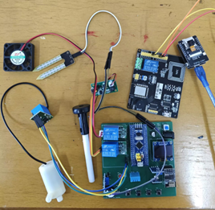
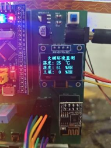
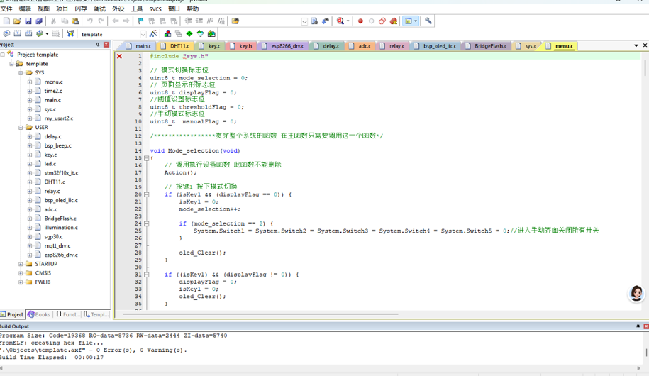
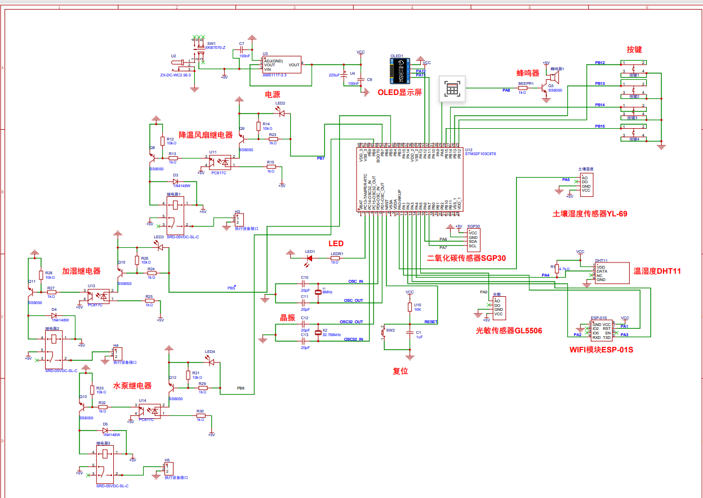

# embed — 嵌入式（STM32）开发辅助 Skill

[](https://github.com/wdcjx/Embedded-programming/releases)
[](LICENSE)


[](https://github.com/wdcjx/Embedded-programming/blob/main/docs/traffic_summary.md)
[](https://github.com/wdcjx/Embedded-programming/blob/main/docs/traffic_summary.md)

[English](#english-quick-overview) · 中文

一个给 AI Agent 用的技能（Skill）：让 Agent 能独立完成简单 STM32 项目的代码生成
（GPIO / UART / TIM / ADC / I2C / SPI / EXTI / DMA / 看门狗 / OLED 显示屏），支持四条轨：
**裸机 SPL（默认）**、**SPL + FreeRTOS**、**裸机 HAL（CubeMX + Keil，起步）**、**HAL + FreeRTOS**，
输出带引脚分配表、接线表、工程文件清单和烧录说明的完整代码。

## 生成结果长什么样

### 真实案例：大棚环境监控节点（用户实测工程）

用本技能辅助完成的真实项目：STM32F103C8T6 采集 DHT11 温湿度、SGP30 二氧化碳、土壤湿度（YL-69）、光敏（GL5506），
三路继电器驱动降温风扇 / 加湿 / 水泵，OLED 实时显示读数，ESP8266（ESP-01S）联网上报，
四个按键 + 菜单切换手动/自动模式——**Keil 编译 0 Error 0 Warning**，上电即稳定运行：

| 硬件实物 | OLED 运行实拍（温度/湿度/土壤） | Keil 编译 0 Error 0 Warning |
|---|---|---|
|  |  |  |

<details>
<summary><b>硬件原理图</b>（点击展开）</summary>



</details>

### 一次简单需求的交付格式（示例节选）

> **需求**：「F103C8T6 串口回显，PC13 LED 心跳，printf 调试」
>
> **交付**：
> 1. `main.c`：完整可编译——HSE 8MHz×9=72MHz 时钟配置、USART1 115200 8N1、printf 重定向（fputc）、SysTick 毫秒节拍非阻塞主循环、USER CODE 分区
> 2. 引脚分配 / 接线表：
>
>    | 信号 | 引脚 | 接到 |
>    |---|---|---|
>    | USART1_TX | PA9 | USB-TTL 模块 RXD |
>    | USART1_RX | PA10 | USB-TTL 模块 TXD |
>    | LED | PC13 | 板载 LED（低电平点亮） |
>    | SWD | PA13/PA14 | ST-Link SWDIO/SWCLK |
>
> 3. 烧录方式：ST-Link SWD 一键下载（含串口 ISP 备选步骤）
> 4. validator 报告：0 VIOLATION——时钟最先开启、ISR 无阻塞调用、硬件等待带超时、NVIC 分组统一

**两种模式**：要一段能跑的简单代码 → 快速模式（直接说需求）；
要"按老手工程纪律生成、审查、检查"的代码 → 纪律模式（默认；提到 规范/审查/检查/validate 即命中）。
两种模式共用同一套 API 文件与模板，纪律文件与检查脚本只在纪律模式强制。

## 安装

**仓库地址**：<https://github.com/wdcjx/Embedded-programming>

- **通用一键安装**（Claude Code / Codex 等主流 Agent CLI）：
  ```bash
  npx skills add wdcjx/Embedded-programming
  ```
  已实测：自动识别技能名 `embed`，完整带上 `references/`、`scripts/`（validator）、`templates/` 等子目录，并生成 `skills-lock.json` 便于团队复现。
  **更新**：`npx skills update embed` 拉取最新版；或者直接对 Agent 说「更新 embed 技能」，技能自带自更新指令（见 SKILL.md）。
- **DeepSeek Harness (DSH)**：侧边栏「技能库」→ 粘贴仓库链接 `https://github.com/wdcjx/Embedded-programming` 安装（自动克隆 + 热加载），
  或把整个 `embed` 文件夹放到 `~/.dsh/skills/embed`；
- **手动**：`git clone https://github.com/wdcjx/Embedded-programming.git`，把克隆出的文件夹改名为 `embed` 放到 `~/.claude/skills/`（或 `~/.dsh/skills/`）。

> 注意：安装时目录名应与 SKILL.md 中的 `name: embed` 一致。

## 触发方式

对 Agent 说：「用 embed 技能生成 STM32F103C8T6 的串口回显程序」
或「帮我写 STM32 标准库点灯 + printf，PA6 输出 PWM」——涉及 STM32 / 单片机 / 标准库 / HAL / CubeMX / FreeRTOS 的需求都会命中。
提到 CubeMX 或 HAL 时自动走 HAL 轨，其余默认 SPL 轨。

## 当前能力

默认目标 **STM32F103C8T6**（72MHz，中密度 MD；其他容量按密度宏/启动文件表适配）。超出表格范围的需求 Agent 会如实说明。

| 能力域 | 内容 | 状态 |
|---|---|---|
| **四轨代码生成** | 裸机 SPL（默认）/ SPL+FreeRTOS / 裸机 HAL（CubeMX+Keil）/ HAL+FreeRTOS；输出含引脚分配表、接线表、工程文件清单、烧录说明；SysTick 毫秒节拍非阻塞主循环 + printf 重定向 | ✅ 四轨集齐（v0.5.4） |
| **外设配方（SPL）** | GPIO / EXTI / USART（printf、RXNE+IDLE 不定长帧）/ TIM（定时中断+PWM）/ ADC（F1 校准）/ I2C 主机（扫描、MPU6050）/ SPI 主机 / IWDG / DAC（HD/XL）/ 传感器驱动小抄（DS18B20 等 14 节） | ✅ recipes §1–14 |
| **显示** | OLED 0.96"（SSD1306，I2C/SPI 双版）；FSMC 驱 TFT-LCD（ILI9341/9328：地址译码/时序/窗口绘图/波形示波器信号链）；HAL 轨 LCD 四总线（SPI/FSMC/FMC/LTDC+DMA2D） | ✅ 多工程实测 |
| **通信与报警** | GSM 模块（SIM800/900）AT 短信：注网自检序列、CMGS 完整流程、回读+超时范式（禁盲等）、报警节流三件套（锁存/冷却/重发升级）、传感器阈值报警架构（滞回） | ✅ 火灾报警工程实测（v0.6.3） |
| **机电控制** | 平衡车三环（直立 PD+速度 PI+转向，并联合成、事件驱动节拍）与四轴串级 PID（角度外环+角速度内环、时间片调度）双范式；桌面宠物四足步态（对角步态、可打断动作、舵机镜像安装）；USV 无人水面艇（五频嵌套取模时间片、Madgwick 9 轴+初始对准+增益衰减、遥控 PWM 双边沿捕获、增量式 PID 取大误差夹挤、树莓派离线 2s 锁电机）；编码器测速（关中断读 CNT 组合圈数法）、H 桥双电机、NRF24L01 无线链路、失联/摔倒/低压/离线安全链四工程对照；A→B 官方 ISR 瘦身整改示范（ISR 刷屏→只置标志） | ✅ 四实测工程（v0.8 / v0.9.2 / v0.9.8 / v0.10.6） |
| **音频与信号处理** | TIM 触发 DAC 波表 DMA（CIRCULAR）+ ADC 外部触发批采样（NORMAL）+ CMSIS-DSP 1024 点 CFFT 频谱链；变频=停-改PSC-跑三行法（不重跑 Init）；AD8402 数字电位器电子音量；F103VCT6（HD 密度，validator --density hd） | ✅ DDS 电子琴+频谱仪工程实测（v0.9.3） |
| **FreeRTOS 集成** | FreeRTOSConfig.h 模板 + 任务骨架、向量接管三宏、FromISR 优先级红线（≥5）、20K RAM 堆预算、Keil 手动集成六步 SOP（SPL 轨）；时基迁 TIM 文件地图、CMSIS V1↔V2、双堆模型（HAL 轨）；**裸机库移植范式**（GRBL→F407+FreeRTOS 实测：职责表/忙等让步点/ISR 安全化/cli-sei 策略/LVGL 集成三件套）；Kernel 10.x~11.x | ✅ 实测工程 validator 0/0 |
| **RTOS 生态移植** | 同板四 RTOS 移植对比（F401RE，ThreadX/Zephyr 首见）：ThreadX×HAL 集成 SOP（_tx_initialize_low_level 逐行/NVIC 0xFF-0xFF-0x40/SysTick 接管/抢占阈值/静态栈线程）、Zephyr HWMv2 板级五件套+dts 声明速查（mipi-dbi-spi 泛生/hc-sr04/esp-at WiFi offload/MCUboot 三分区/west build）、RT-Thread Studio 工程结构、FreeRTOS 三形态（CubeMX/手挂/CMake）、四轨时钟不统一实录（HSI vs HSE） | ✅ RocketPi 四轨文件级（v0.10.2） |
| **温控与低速执行器** | 300W 加热台温控器（首个 IAR+F103C6T6 低密度工程）：HSI 无晶振 64MHz 方案与时基连锁重算、MAX6675 位拆测温+去极值滤波（除数 N−2）、位置式 PID+秒级低频 PWM 三保险（软开关/上限/死区）、Flash 追加式磨损均衡参数区+掉电安全、ST7735S 160×80 长条屏表驱动 UI、WFI 低功耗主循环、IAR→Keil 移植差异 | ✅ 加热台工程实测（v0.9.4） |
| **多机协同机器人** | 7 节点系统（遥控/底盘/云台/灯条/发射/双 4310 FOC，F103+F105+F407 混编 HAL+FreeRTOS）：NRF 同地址广播拓扑与 ACK 冲突边界、全系统 20 字节帧协议（浮点×100 编码/环形滑窗同步/无 CRC 风险）、底盘 BMI055+Mahony 1ms 姿态链+双 PID（小陀螺/跟随）+全向轮运动学+云台→底盘坐标旋转、正点原子任务模板通病（start_task 自杀死码/句柄复制）、MspInit 强符号抢占致时钟无声缺失（validator 抓到的真硬件 bug） | ✅ 多节点工程实测（v0.9.5） |
| **低功耗与可穿戴** | F411 智能手表（LVGL 8.2+FreeRTOS CMSIS_V2，实测上板）：STOP 休眠全套（两级休眠/醒-查-再睡/RTOS 进 STOP 三件套 SuspendAll+关 TICKINT+外狗/醒后重配时钟）、外部看狗 GPIO 喂狗（IWDG 停不掉的替代）、主电源自锁+充电内阻压降补偿 11 段电池曲线、IAP 双固件升级（APP FLAG 掉电安全/Ymodem/跳转五件套/VTOR 与 IROM1 同步）、LVGL 自适应节拍+页面栈+HW_USE 硬件抽象（PC 模拟器同源）、ST7789 DMA flush+BSY 等待、传感器按页唤醒省电矩阵、抬腕/翻腕手势链 | ✅ OV-Watch 智能手表实测（v0.9.6） |
| **FOC 电机控制** | SimpleFOC 算法 HAL 移植（F105+AS5600+相电流采样）：SVPWM 六扇区表与 0.577 调制比、上电校零流程（开环拖动→锁 3π/2→读零电角）、三环 PID 梯形积分+SysTick Ts、低通滤波、电流采样简化 Clarke、单位混乱实录（count/度/弧度）、25kHz 中心对齐互补 PWM 死区警示 | ✅ 4310 直驱工程实测（v0.9.5） |
| **跨家族** | F103C8T6 默认；F407VET6 起步（168MHz 时钟树模板、TIM2/TIM5 32 位、F1→F4 差异对照、换轨清单、CoreScribe 移植工程）；F411CEU6 智能手表（HSI 100MHz 无晶振、STOP 低功耗、LVGL、IAP 双固件）；F7/H7/G0/G4/L4 无标准库，走 HAL 轨并声明未实测校对 | F407 机器人节点与 F411 智能手表均已上板（v0.9.5/v0.9.6），validator `--density f4` |
| **多协议总线工具** | 多协议总线分析仪（F407VET6 HAL+LVGL 实测上板，**首个 CMake/CLion+arm-none-eabi-gcc 样本**）：9 端口（3 UART 含 RS485/2 CAN/2 SPI/2 I2C）监视+网桥+信号源探针三形态、HAL 弱回调=ISR 的 update 标志消费数据流、双时基（SysTick=HAL+TIM=lv_tick）、自研 APP 框架+椭圆轨道 PD 缓动菜单、CMake 工程四件事（.ld/GLOB_RECURSE/objcopy/OpenOCD）、FPU 编译选项必查 | ✅ Linno 总线分析仪实测（v0.10.0） |
| **门禁与人体测温** | 智能防疫门禁（F103C6Tx，**技能库最小目标芯片 32K Flash/10K RAM**）：MLX90614 非接触红外测温 SMBus 软件驱动（协议帧/PEC CRC-8 0x107/temp=raw×0.02−273.15/PWM→SMBus 切换/睡眠退出）、门禁判定链三分支（无效驻留/正常放行/异常人工解除）、舵机 CCR=angle/9+5、ST7735 QDtech 显示层、.ioc 与代码引脚漂移实例（busy PB2↔PB1）、PEC 前缀填错=校验恒失败仍返回数据、淘宝驱动 SPL→HAL 移植三查 | ✅ 门禁工程实测（v0.10.1） |
| **工业通信与计量** | FreeModbus RTU 从机移植（BARE 四 port 文件职责/三件套契约/寄存器数组界面/RS485 方向钩子警示）、CAN 收发（位时序公式 baud=PCLK/(PSC×(1+BS1+BS2))/F1 收脚上拉输入与 USB 共用向量/过滤器组态/邮箱收发）、HLW8110 智能配电单元架构（Modbus 参数 EEPROM 化+IAP 从机 VTOR+四串口分工）、WS2812B PWM+DMA 双缓冲乒乓模板（99 行全量）、RC522 RFID 流程与 osDelay 宏适配、开源仓库不完整性检查（arm32_open 26 子工程横评） | ✅ 文件级（v0.10.3，Modbus+CAN 首见） |
| **达妙电机与伺服执行器** | 推板机器人控制固件（F407ZET6 SPL+FreeRTOS，**首个 validator 零违规工程**）：达妙 DM 电机 MIT 协议全解（8B 位域帧 p16/v12/Kp12/Kd12/t12+float↔uint 线性映射+使能 0xFC/失能 0xFD/设零 0xFE+反馈状态码）、使能重试（上电 1~2s 启动窗口帧全丢）、多圈累计位置（±P_MAX 回绕补偿）、ID 扫描双模式（CAN ACK≠认帧）、PI 力矩前馈实测数据、CAN 诊断十连命令（CANERR/LOOPTEST 内部回环/CANSCOPE DWT 示波器/STB 五态扫描——"每条命令只切一刀"方法论）、NART 邮箱锁死与 CAN_Prescaler 语义两颗实战金坑、ESP-NOW 无线串口桥、CH9121 网口模块 TCP 流切包+单读者设计、OpenOCD 命令行烧录（Keil 5.20 驱动认不出新 DAPLink 的解法+ASCII 路径规矩） | ✅ 推板机器人实测（v0.10.7，达妙/ESP-NOW/网口模块/OpenOCD 首见） |
| **电池管理系统（BMS）** | PackLink-BMS（F103C8T6+BQ76940 9 串，HAL+FreeRTOS，**首个 BMS/AFE 样本+首个带单元测试工程**）：BQ769x0 驱动全解（9S 逻辑→VC 通道索引表/GAIN+OFFSET 每次采样重读抗漂移/OV-UV trip 逆换算/SYS_STAT 映射/均衡寄存器 idx÷5 选位/wake 时序）、依赖注入三通道（运行时 bind/ops 虚表/__weak 存储钩子→业务零 HAL 依赖）、软件保护回差策略+手动 MOS 与保护优先级（开 MOS 必清锁存）、SOC 双路径（OCV 七点重锚+安时积分）、通信三协议共享命令处理器（RS485 ASCII/50B 工具帧/CAN 0x01~07+0x101 ACK）、BQRAW 诊断事务=volatile 标志+跳拍软互斥、36 用例 fail-fast 手写 runner+fake 后端注入、裸机/RTOS 双模式同一套业务 | ✅ BMS 工程实测（v0.10.8，BQ769x0/单元测试首见） |
| **工程纪律与静态检查** | `validate_generated.py`：时钟使能顺序、volatile/ISR 纪律、ISR 阻塞调用、等待超时、NVIC 分组、向量名、HAL 回调、RTOS API 误用——VIOLATION 清零才交付；坑清单 88 条（每条症状/原因/修法）；症状速查 14 条反查表；`__HAL_LOCK`/Mutex/临界区/栈堆精算/Cache+DMA 现场可靠性知识 | ✅ 6 个自测样本持续回归 |

## 纪律是怎么保证的：三层防线

生成的代码凭什么可信？**不依赖模型"自觉"，靠流程与工具分层强制**：

| 层 | 机制 | 管什么 | 强度 |
|---|---|---|---|
| ① 结构层 | SKILL.md 每次会话强制加载：工作流程、硬约束、自检清单 | 模式路由（SPL/HAL × 裸机/RTOS 四轨）、交付四件套（代码+接线表+烧录方式+未编译声明）、默认假设芯片与引脚表先行 | 硬性，不依赖模型状态 |
| ② 知识层 | 30 篇 references 按需注入（资源表=路由表：生成 F4 先读 f4-family-notes、写 ISR 前读 isr-and-concurrency-rules） | 领域正确性：外设时序、RTOS 原语、88 条实测坑的反面模式 | 生成对应领域代码时命中 |
| ③ 客观层 | validator 脚本跑生成的每个 .c 文件，**VIOLATION 清零才交付**；多文件工程自动聚合所有 EMBED MANIFEST 声明块做跨文件检查 | 单文件：时钟顺序、volatile、ISR 阻塞、等待超时、NVIC 分组、向量名等约 20 类；跨文件：引脚冲突、中断向量重复 | 机器兜底，不采信模型自述 |

**诚实的边界**（写在这里而不是藏起来）：

1. **跨文件一致性曾是最大盲区**——A 文件用 PB3、B 文件又配 PB3 这类引脚冲突（坑 76 即此案例）。v0.11.1 起已有机器解法：交付的每个 .c 头部带机器可读 EMBED MANIFEST 块（声明本文件占用的引脚/向量），validator 聚合所有块自动查跨文件冲突；存量无块工程仍是弱项，靠自检清单的全工程引脚表对照。
2. **validator 查纪律，不查逻辑**——PID 方向、状态机转移、协议字段这类业务正确性它不管，靠模型+你的实测。
3. **超长一次性生成会衰减**——上千行的细节纪律（U 后缀、volatile 逐一核查）随长度松弛，这是所有模型的物理规律。

因此**长代码的正确用法是分模块迭代**，而不是"一次写完 2000 行然后祈祷"：

```
第 1 轮：架构 + 全工程引脚表 + 时钟方案（先对总账）
第 2 轮：外设驱动逐个生成，每个跑 validator（VIOLATION 清零）
第 3 轮：业务逻辑 / 任务划分
每轮交付都带 validator 结果 → 你在 Keil 编译烧录 → 反馈实测问题 → 迭代
```

单轮压缩到几百行以内，三层防线就都在满血状态——这个流程本身就是 SKILL.md 工作流程的一部分。

## 常见问题

### 模板在 VS Code 里报「无法打开源文件 stm32f10x.h / stdio.h」（C/C++ 1696）

这是预期现象，不是代码错误：

- `stm32f10x.h` 在 **STM32 标准外设库（SPL）包**里，模板单独存放时自然找不到；
- `stdio.h` 在**编译器工具链**（Keil ARMCC / arm-none-eabi-gcc）里。

模板要放进含 SPL 的实际工程使用。若想在 VS Code 中获得 IntelliSense：
下载 SPL（ST 官网或 GitHub 镜像，如 `STM32F10x_StdPeriph_Lib`），在工作区建 `.vscode/c_cpp_properties.json`：

```json
{
  "configurations": [{
    "name": "STM32",
    "compilerPath": "C:/Keil_v5/ARM/ARMCC/bin/armcc.exe",
    "defines": ["STM32F10X_MD", "HSE_VALUE=8000000", "USE_STDPERIPH_DRIVER"],
    "includePath": [
      "${workspaceFolder}/**",
      "C:/path/to/STM32F10x_StdPeriph_Lib/Libraries/CMSIS/Device/ST/STM32F10x/Include",
      "C:/path/to/STM32F10x_StdPeriph_Lib/Libraries/CMSIS/Include",
      "C:/path/to/STM32F10x_StdPeriph_Lib/Libraries/STM32F10x_StdPeriph_Driver/inc"
    ]
  }]
}
```

（用 GCC 时 `compilerPath` 指向 `arm-none-eabi-gcc`；只用 Keil 编译也可以直接无视该报错。）

## 反馈与社区

- 问题/建议：[Issues](https://github.com/wdcjx/Embedded-programming/issues)——提问前先搜
  [references/known-pitfalls.md](references/known-pitfalls.md)（88 条实测坑）与
  [references/symptom-quickref.md](references/symptom-quickref.md)（症状反查表）；
- 经验交流/求助：[Discussions](https://github.com/wdcjx/Embedded-programming/discussions)；
- 想沉淀自己的实测工程或增强 validator：规矩见 [CONTRIBUTING.md](CONTRIBUTING.md)。

## 文件结构

<details>
<summary>目录树（点击展开）</summary>

```
embed/                                # 单一技能：快速生成 + 工程纪律两种模式
├── SKILL.md                          # 入口：模式路由、工作流、硬约束、自检清单
├── README.md                         # 本文件
├── LICENSE                           # MIT
├── ROADMAP.md                        # 后续计划
├── CONTRIBUTING.md                   # 贡献指南（反馈渠道/沉淀规矩/validator 回归要求）
├── .github/ISSUE_TEMPLATE/           # Issue 模板（问题反馈/工程沉淀建议）
├── references/
│   ├── stm32-stdperiph-api.md        # 标准库 API 速查 + 密度宏/工程文件清单 + 内部 FLASH/UID（§13）
│   ├── peripheral-recipes.md         # 典型外设配方（点灯/串口/PWM/ADC/I2C/SPI…）+ 参数掉电保存（§15）
│   ├── freertos-spl-integration.md   # SPL+FreeRTOS 集成规则（向量接管/FromISR/内存预算）
│   ├── oled-ssd1306.md               # OLED 0.96"（SSD1306）驱动知识（I2C/SPI 双版）
│   ├── hal-basics.md                 # HAL 轨：CubeMX/句柄模型/SPL→HAL 对照/F1 坑/RTOS 铁律
│   ├── hal-driver-patterns.md        # HAL 第三方驱动范式（I2C/SPI/DWT 延时/传感器读数/W5500+DW1000 移植层，HAL_Driver_Lib 基准）
│   ├── freertos-hal-integration.md   # HAL+FreeRTOS 完整集成（CubeMX 实测：时基 TIM2/三宏联动/双堆）
│   ├── grbl-port-f407.md             # 裸机强实时库→STM32+FreeRTOS 移植范式（GRBL/F407 实测）
│   ├── hal-freertos-field-guide.md   # 现场可靠性：__HAL_LOCK/Mutex/临界区/栈堆精算/Cache+DMA/低功耗
│   ├── symptom-quickref.md           # 症状速查：死机/挂死/数据乱 → 根因反查
│   ├── fsmc-lcd-ili9341.md           # FSMC 驱 TFT-LCD（ILI9341，HD/XL）：地址译码/时序/绘图/坑
│   ├── f4-family-notes.md            # F4 起步（F407VET6 实测）：168MHz 时钟树/F1→F4 差异对照/换轨清单
│   ├── gsm-at-sms.md                 # GSM 模块 AT 短信报警（SIM800/900）：注网自检/CMGS/回读+超时/节流
│   ├── quad-drone-spl.md             # 2.4G 四轴遥控/飞控双机系统（F103 SPL 实测）：串级 PID/NRF 链路/混控/安全链
│   ├── balance-car-spl.md            # 两轮平衡小车（F103 SPL 实测）：事件驱动节拍/三环并联合成/现场妥协与安全链对比
│   ├── desktop-pet-spl.md            # 桌面宠物四足机器人（F103C8 SPL 实测）：单字节命令协议/对角步态/ISR 瘦身整改对照/国产芯直烧实证
│   ├── audio-dds-fft-hal.md          # DDS 电子琴+FFT 频谱仪（F103VCT6 HAL 实测）：DAC 波表 DMA/CFFT/变频三行法/AD8402
│   ├── display-storage-hal.md        # LCD 四总线+SDRAM+QSPI（HAL 实测）：选型表/DMA2D/刷新率公式/bug 清单
│   ├── heater-temp-control-spl.md     # 300W 加热台温控器（F103C6T6 SPL·IAR 实测）：HSI 64MHz/MAX6675/PID 低频 PWM/Flash 磨损均衡/WFI
│   ├── multi-node-robot-rtos-hal.md   # 多节点机器人（F103/F105/F407 HAL+FreeRTOS 实测）：NRF 广播/20B 帧协议/全向轮运动学/任务模板通病
│   ├── foc-motor-hal.md               # FOC 无刷直驱（F105+AS5600 HAL 实测）：SVPWM/校零/三环 PID/电流采样/单位混乱实录
  ├── smartwatch-lvgl-lp-hal.md      # 智能手表（F411 HAL+FreeRTOS+LVGL 实测上板）：STOP 低功耗三件套/IAP 双固件/LVGL 集成/传感器按页唤醒
  ├── bus-analyzer-lvgl-hal.md      # 多协议总线分析仪（F407 HAL+LVGL+CMake 实测上板）：9 端口监视/网桥/HAL 回调数据流/双时基/CMake 迁移
  ├── gate-access-mlx90614-hal.md  # 智能防疫门禁（F103C6 最小目标+MLX90614）：SMBus 驱动/门禁判定链/.ioc 漂移与 PEC 前缀 bug
  ├── rocketpi-rtos-ports.md     # 同板四 RTOS 移植对比（F401RE）：ThreadX 集成 SOP/Zephyr 板级五件套+dts/RT-Thread Studio/FreeRTOS 三形态
  ├── industrial-comms-modbus-can-hal.md  # 工业通信与计量（FreeModbus RTU/CAN/RS485/HLW8110）：四 port 移植/位时序公式/WS2812B 双缓冲/RC522
  ├── queue-gate-rtos-hal.md       # 智能排队闸机（FreeRTOS 原语全家桶教学样本）：任务通知/计数信号量资源池/LCD1602 首见
  ├── yuyu-library-f4-spl-rtos.md  # YUYU 自建外设库（F407+SPL+FreeRTOS 首见）：SPI 协议 WiFi/RTOS 串口教科书/三屏适配层/零 VIOLATION 正面基准
  ├── usv-autonomous-boat-spl.md  # USV 无人水面艇（GPS UBX/Madgwick/遥控捕获首见）：五频时间片/Eastar 链路/低有效 PWM
  ├── damiao-motor-can-f4-spl.md  # 达妙电机机器人（达妙 MIT 协议/ESP-NOW 桥/网口模块/OpenOCD 首见）：CAN 诊断十连/首个零违规工程
  ├── bms-bq769x0-hal.md          # PackLink-BMS 电池管理（BQ769x0 AFE/单元测试首见）：依赖注入三通道/保护回差/SOC 双路径/36 用例
  ├── portable-lib-design.md       # 可移植单文件库设计范式（MultiButton 全解）：事件回调/位域压缩/锁外回调/mock 单测
  ├── spl-peripheral-checklist.md   # 外设初始化顺序清单（纪律）
  ├── isr-and-concurrency-rules.md  # ISR/并发/volatile/临界区规则（纪律）
  └── known-pitfalls.md             # 已知坑清单（纪律）
├── templates/
│   ├── main.c                        # 裸机 SPL 工程骨架模板
│   ├── main_rtos_spl.c               # SPL+FreeRTOS 任务工程骨架模板
│   ├── FreeRTOSConfig.h              # F103 中密度 FreeRTOS 配置模板（Kernel 10.x~11.x）
│   └── main_hal.c                    # 裸机 HAL 骨架（CubeMX 对照 + 手写起点）
├── assets/
│   ├── spl-project-template.md       # Keil 工程组织/必配项/占用估算
│   └── images/                       # 首页真实案例展示图
├── examples/
│   └── blink_uart_demo/main.c         # bring-up 试例：点灯 + 串口打印版本/编译时间/运行时长
├── scripts/
│   ├── validate_generated.py         # 静态纪律检查（VIOLATION 必须清零，含 RTOS/HAL 规则与 MANIFEST 聚合）
│   └── ci_check.py                   # CI 回归：六样本基线 + 聚合基线 + 仓库一致性
└── tests/
    ├── bad_sample.c                  # 裸机违规自测样本
    ├── bad_sample_rtos.c             # RTOS 违规自测样本
    ├── bad_sample_hal.c              # HAL 违规自测样本
    ├── project_conflict/             # 聚合样本：两文件抢 PA9（坑 76 场景），--dir 必报冲突
    └── manifest_ok/                  # 聚合样本：引脚/向量无交集，--dir 应 PASS
```

</details>

## 许可

MIT

---

## English Quick Overview

An **agent skill** for STM32 embedded development — give your AI agent
(Claude Code, Codex CLI, DeepSeek Harness, …) the ability to generate
complete, discipline-checked firmware on its own.

### What it generates

- Four tracks: **bare-metal SPL** (default), **SPL + FreeRTOS**,
  **bare-metal HAL** (CubeMX + Keil), **HAL + FreeRTOS**
- Peripherals: GPIO / UART / TIM / ADC / I2C / SPI / EXTI / DMA / WDT /
  DAC / OLED — plus domain recipes (motor control, low-power, displays,
  comms, sensors) distilled from real projects
- Every delivery includes a **pin allocation table, wiring table,
  project file list, and flashing instructions**
- Default target **STM32F103C8T6**; family adaptation across F1
  (C6/C8/RC/VC, density macros + startup files) and F4
  (F401/F407/F411); other families fall back to HAL track with an
  honest "not field-tested" statement

### Quality gate

Discipline does not rely on the model behaving well — it is enforced by
three layers: **① structure** (SKILL.md workflow/hard constraints/checklist
loaded every session), **② knowledge** (30 on-demand reference docs routed
by domain), **③ objective** (the validator script — VIOLATION must reach
zero before delivery; for multi-file projects it also aggregates the
machine-readable `EMBED MANIFEST` block in each delivered file to catch
cross-file pin conflicts and duplicate interrupt vectors).

- `scripts/validate_generated.py` — a static discipline checker
  (clock-enable order, volatile/ISR discipline, blocking-in-ISR,
  busy-wait timeouts, NVIC grouping, vector names, HAL callbacks,
  RTOS API misuse). Code ships only when **VIOLATION count is zero**
- `references/known-pitfalls.md` — **88 field-tested pitfalls**, each
  with symptom / root cause / fix, harvested from 20+ real open-source
  and user projects (quadcopter, balance car, FOC motor, smartwatch,
  bus analyzer, heater controller, industrial Modbus/CAN nodes…)
- Since v0.11.1 multi-file deliverables carry a machine-readable
  `EMBED MANIFEST` block per file, so cross-file pin conflicts and
  duplicate vectors are caught by aggregation instead of eyeballing;
  known blind spots (business logic) are documented honestly, and the
  recommended workflow is iterative module-by-module generation (each
  round ships with validator output)
- CI regression on every push pins the checker baseline and keeps docs
  and indexes consistent

### Install

```bash
npx skills add wdcjx/Embedded-programming
```

Update later with `npx skills update embed` (or just ask your agent to "update the embed skill" - it ships with self-update instructions).

Or clone, rename the folder to `embed`, and drop it into
`~/.claude/skills/` (or `~/.dsh/skills/`).

### Notes for non-Chinese readers

The reference docs are written in Chinese; code, tables, and the
checker output are language-neutral, and generated code follows your
conversation language. The [file tree](#文件结构) above doubles as a
content index.

[↑ back to top](#readme)
