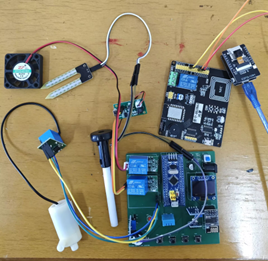
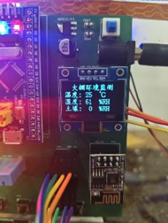
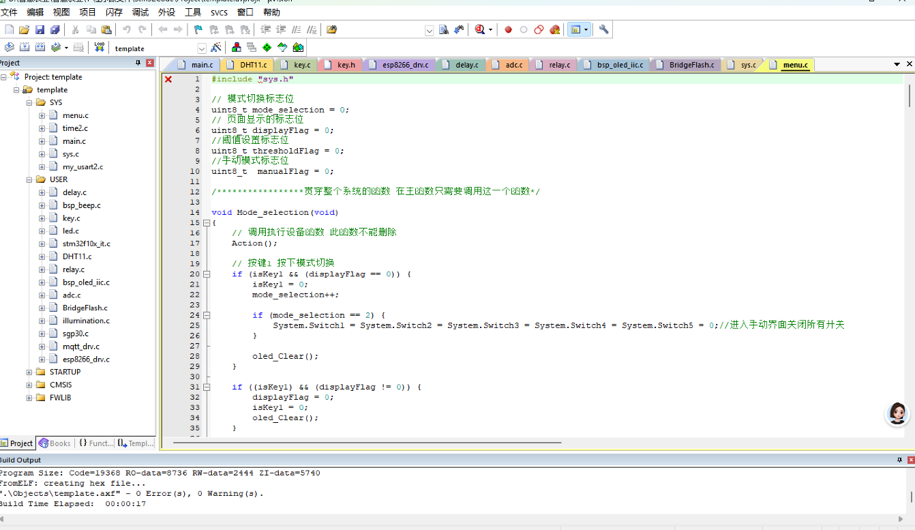
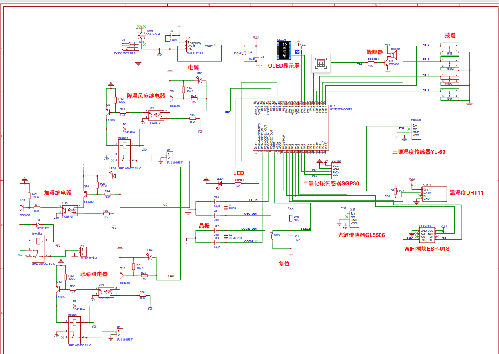

# embed — 嵌入式（STM32）开发辅助 Skill

[](https://github.com/wdcjx/Embedded-programming/releases)
[](LICENSE)


[](https://github.com/wdcjx/Embedded-programming/blob/main/docs/traffic_summary.md)
[](https://github.com/wdcjx/Embedded-programming/blob/main/docs/traffic_summary.md)

一个给 AI Agent 用的技能（Skill）：让 Agent 能独立完成简单 STM32 项目的代码生成
（GPIO / UART / TIM / ADC / I2C / SPI / EXTI / DMA / 看门狗 / OLED 显示屏），支持四条轨：
**裸机 SPL（默认）**、**SPL + FreeRTOS**、**裸机 HAL（CubeMX + Keil，起步）**、**HAL + FreeRTOS**，
输出带引脚分配表、接线表、工程文件清单和烧录说明的完整代码。

## 生成结果长什么样

### 真实案例：大棚环境监控节点（用户实测工程）

用本技能辅助完成的真实项目：STM32F103C8T6 采集 DHT11 温湿度、SGP30 二氧化碳、土壤湿度（YL-69）、光敏（GL5506），
三路继电器驱动降温风扇 / 加湿 / 水泵，OLED 实时显示读数，ESP8266（ESP-01S）联网上报，
四个按键 + 菜单切换手动/自动模式——**Keil 编译 0 Error 0 Warning**，上电即稳定运行：

| 硬件实物 | OLED 运行实拍（温度/湿度/土壤） | Keil 编译 0 Error 0 Warning |
|---|---|---|
|  |  |  |

<details>
<summary><b>硬件原理图</b>（点击展开）</summary>



</details>

### 一次简单需求的交付格式（示例节选）

> **需求**：「F103C8T6 串口回显，PC13 LED 心跳，printf 调试」
>
> **交付**：
> 1. `main.c`：完整可编译——HSE 8MHz×9=72MHz 时钟配置、USART1 115200 8N1、printf 重定向（fputc）、SysTick 毫秒节拍非阻塞主循环、USER CODE 分区
> 2. 引脚分配 / 接线表：
>
>    | 信号 | 引脚 | 接到 |
>    |---|---|---|
>    | USART1_TX | PA9 | USB-TTL 模块 RXD |
>    | USART1_RX | PA10 | USB-TTL 模块 TXD |
>    | LED | PC13 | 板载 LED（低电平点亮） |
>    | SWD | PA13/PA14 | ST-Link SWDIO/SWCLK |
>
> 3. 烧录方式：ST-Link SWD 一键下载（含串口 ISP 备选步骤）
> 4. validator 报告：0 VIOLATION——时钟最先开启、ISR 无阻塞调用、硬件等待带超时、NVIC 分组统一

**两种模式**：要一段能跑的简单代码 → 快速模式（直接说需求）；
要"按老手工程纪律生成、审查、检查"的代码 → 纪律模式（默认；提到 规范/审查/检查/validate 即命中）。
两种模式共用同一套 API 文件与模板，纪律文件与检查脚本只在纪律模式强制。

## 安装

**仓库地址**：<https://github.com/wdcjx/Embedded-programming>

- **通用一键安装**（Claude Code / Codex 等主流 Agent CLI）：
  ```bash
  npx skills add wdcjx/Embedded-programming
  ```
  已实测：自动识别技能名 `embed`，完整带上 `references/`、`scripts/`（validator）、`templates/` 等子目录，并生成 `skills-lock.json` 便于团队复现。
- **DeepSeek Harness (DSH)**：侧边栏「技能库」→ 粘贴仓库链接 `https://github.com/wdcjx/Embedded-programming` 安装（自动克隆 + 热加载），
  或把整个 `embed` 文件夹放到 `~/.dsh/skills/embed`；
- **手动**：`git clone https://github.com/wdcjx/Embedded-programming.git`，把克隆出的文件夹改名为 `embed` 放到 `~/.claude/skills/`（或 `~/.dsh/skills/`）。

> 注意：安装时目录名应与 SKILL.md 中的 `name: embed` 一致。

## 触发方式

对 Agent 说：「用 embed 技能生成 STM32F103C8T6 的串口回显程序」
或「帮我写 STM32 标准库点灯 + printf，PA6 输出 PWM」——涉及 STM32 / 单片机 / 标准库 / HAL / CubeMX / FreeRTOS 的需求都会命中。
提到 CubeMX 或 HAL 时自动走 HAL 轨，其余默认 SPL 轨。

## 当前能力

默认目标 **STM32F103C8T6**（72MHz，中密度 MD；其他容量按密度宏/启动文件表适配）。超出表格范围的需求 Agent 会如实说明。

| 能力域 | 内容 | 状态 |
|---|---|---|
| **四轨代码生成** | 裸机 SPL（默认）/ SPL+FreeRTOS / 裸机 HAL（CubeMX+Keil）/ HAL+FreeRTOS；输出含引脚分配表、接线表、工程文件清单、烧录说明；SysTick 毫秒节拍非阻塞主循环 + printf 重定向 | ✅ 四轨集齐（v0.5.4） |
| **外设配方（SPL）** | GPIO / EXTI / USART（printf、RXNE+IDLE 不定长帧）/ TIM（定时中断+PWM）/ ADC（F1 校准）/ I2C 主机（扫描、MPU6050）/ SPI 主机 / IWDG / DAC（HD/XL）/ 传感器驱动小抄（DS18B20 等 14 节） | ✅ recipes §1–14 |
| **显示** | OLED 0.96"（SSD1306，I2C/SPI 双版）；FSMC 驱 TFT-LCD（ILI9341/9328：地址译码/时序/窗口绘图/波形示波器信号链）；HAL 轨 LCD 四总线（SPI/FSMC/FMC/LTDC+DMA2D） | ✅ 多工程实测 |
| **通信与报警** | GSM 模块（SIM800/900）AT 短信：注网自检序列、CMGS 完整流程、回读+超时范式（禁盲等）、报警节流三件套（锁存/冷却/重发升级）、传感器阈值报警架构（滞回） | ✅ 火灾报警工程实测（v0.6.3） |
| **机电控制** | 平衡车三环（直立 PD+速度 PI+转向，并联合成、事件驱动节拍）与四轴串级 PID（角度外环+角速度内环、时间片调度）双范式；桌面宠物四足步态（对角步态、可打断动作、舵机镜像安装）；编码器测速、H 桥双电机、NRF24L01 无线链路、失联/摔倒/低压安全链设计对照；A→B 官方 ISR 瘦身整改示范（ISR 刷屏→只置标志） | ✅ 三实测工程（v0.8 / v0.9.2 / v0.9.8） |
| **音频与信号处理** | TIM 触发 DAC 波表 DMA（CIRCULAR）+ ADC 外部触发批采样（NORMAL）+ CMSIS-DSP 1024 点 CFFT 频谱链；变频=停-改PSC-跑三行法（不重跑 Init）；AD8402 数字电位器电子音量；F103VCT6（HD 密度，validator --density hd） | ✅ DDS 电子琴+频谱仪工程实测（v0.9.3） |
| **FreeRTOS 集成** | FreeRTOSConfig.h 模板 + 任务骨架、向量接管三宏、FromISR 优先级红线（≥5）、20K RAM 堆预算、Keil 手动集成六步 SOP（SPL 轨）；时基迁 TIM 文件地图、CMSIS V1↔V2、双堆模型（HAL 轨）；**裸机库移植范式**（GRBL→F407+FreeRTOS 实测：职责表/忙等让步点/ISR 安全化/cli-sei 策略/LVGL 集成三件套）；Kernel 10.x~11.x | ✅ 实测工程 validator 0/0 |
| **温控与低速执行器** | 300W 加热台温控器（首个 IAR+F103C6T6 低密度工程）：HSI 无晶振 64MHz 方案与时基连锁重算、MAX6675 位拆测温+去极值滤波（除数 N−2）、位置式 PID+秒级低频 PWM 三保险（软开关/上限/死区）、Flash 追加式磨损均衡参数区+掉电安全、ST7735S 160×80 长条屏表驱动 UI、WFI 低功耗主循环、IAR→Keil 移植差异 | ✅ 加热台工程实测（v0.9.4） |
| **多机协同机器人** | 7 节点系统（遥控/底盘/云台/灯条/发射/双 4310 FOC，F103+F105+F407 混编 HAL+FreeRTOS）：NRF 同地址广播拓扑与 ACK 冲突边界、全系统 20 字节帧协议（浮点×100 编码/环形滑窗同步/无 CRC 风险）、底盘 BMI055+Mahony 1ms 姿态链+双 PID（小陀螺/跟随）+全向轮运动学+云台→底盘坐标旋转、正点原子任务模板通病（start_task 自杀死码/句柄复制）、MspInit 强符号抢占致时钟无声缺失（validator 抓到的真硬件 bug） | ✅ 多节点工程实测（v0.9.5） |
| **低功耗与可穿戴** | F411 智能手表（LVGL 8.2+FreeRTOS CMSIS_V2，实测上板）：STOP 休眠全套（两级休眠/醒-查-再睡/RTOS 进 STOP 三件套 SuspendAll+关 TICKINT+外狗/醒后重配时钟）、外部看狗 GPIO 喂狗（IWDG 停不掉的替代）、主电源自锁+充电内阻压降补偿 11 段电池曲线、IAP 双固件升级（APP FLAG 掉电安全/Ymodem/跳转五件套/VTOR 与 IROM1 同步）、LVGL 自适应节拍+页面栈+HW_USE 硬件抽象（PC 模拟器同源）、ST7789 DMA flush+BSY 等待、传感器按页唤醒省电矩阵、抬腕/翻腕手势链 | ✅ OV-Watch 智能手表实测（v0.9.6） |
| **FOC 电机控制** | SimpleFOC 算法 HAL 移植（F105+AS5600+相电流采样）：SVPWM 六扇区表与 0.577 调制比、上电校零流程（开环拖动→锁 3π/2→读零电角）、三环 PID 梯形积分+SysTick Ts、低通滤波、电流采样简化 Clarke、单位混乱实录（count/度/弧度）、25kHz 中心对齐互补 PWM 死区警示 | ✅ 4310 直驱工程实测（v0.9.5） |
| **跨家族** | F103C8T6 默认；F407VET6 起步（168MHz 时钟树模板、TIM2/TIM5 32 位、F1→F4 差异对照、换轨清单、CoreScribe 移植工程）；F411CEU6 智能手表（HSI 100MHz 无晶振、STOP 低功耗、LVGL、IAP 双固件）；F7/H7/G0/G4/L4 无标准库，走 HAL 轨并声明未实测校对 | F407 机器人节点与 F411 智能手表均已上板（v0.9.5/v0.9.6），validator `--density f4` |
| **工程纪律与静态检查** | `validate_generated.py`：时钟使能顺序、volatile/ISR 纪律、ISR 阻塞调用、等待超时、NVIC 分组、向量名、HAL 回调、RTOS API 误用——VIOLATION 清零才交付；坑清单 69 条（每条症状/原因/修法）；症状速查 14 条反查表；`__HAL_LOCK`/Mutex/临界区/栈堆精算/Cache+DMA 现场可靠性知识 | ✅ 6 个自测样本持续回归 |

## 常见问题

### 模板在 VS Code 里报「无法打开源文件 stm32f10x.h / stdio.h」（C/C++ 1696）

这是预期现象，不是代码错误：

- `stm32f10x.h` 在 **STM32 标准外设库（SPL）包**里，模板单独存放时自然找不到；
- `stdio.h` 在**编译器工具链**（Keil ARMCC / arm-none-eabi-gcc）里。

模板要放进含 SPL 的实际工程使用。若想在 VS Code 中获得 IntelliSense：
下载 SPL（ST 官网或 GitHub 镜像，如 `STM32F10x_StdPeriph_Lib`），在工作区建 `.vscode/c_cpp_properties.json`：

```json
{
  "configurations": [{
    "name": "STM32",
    "compilerPath": "C:/Keil_v5/ARM/ARMCC/bin/armcc.exe",
    "defines": ["STM32F10X_MD", "HSE_VALUE=8000000", "USE_STDPERIPH_DRIVER"],
    "includePath": [
      "${workspaceFolder}/**",
      "C:/path/to/STM32F10x_StdPeriph_Lib/Libraries/CMSIS/Device/ST/STM32F10x/Include",
      "C:/path/to/STM32F10x_StdPeriph_Lib/Libraries/CMSIS/Include",
      "C:/path/to/STM32F10x_StdPeriph_Lib/Libraries/STM32F10x_StdPeriph_Driver/inc"
    ]
  }]
}
```

（用 GCC 时 `compilerPath` 指向 `arm-none-eabi-gcc`；只用 Keil 编译也可以直接无视该报错。）

## 反馈与社区

- 问题/建议：[Issues](https://github.com/wdcjx/Embedded-programming/issues)——提问前先搜
  [references/known-pitfalls.md](references/known-pitfalls.md)（69 条实测坑）与
  [references/symptom-quickref.md](references/symptom-quickref.md)（症状反查表）；
- 经验交流/求助：[Discussions](https://github.com/wdcjx/Embedded-programming/discussions)；
- 想沉淀自己的实测工程或增强 validator：规矩见 [CONTRIBUTING.md](CONTRIBUTING.md)。

## 文件结构

<details>
<summary>目录树（点击展开）</summary>

```
embed/                                # 单一技能：快速生成 + 工程纪律两种模式
├── SKILL.md                          # 入口：模式路由、工作流、硬约束、自检清单
├── README.md                         # 本文件
├── LICENSE                           # MIT
├── ROADMAP.md                        # 后续计划
├── CONTRIBUTING.md                   # 贡献指南（反馈渠道/沉淀规矩/validator 回归要求）
├── .github/ISSUE_TEMPLATE/           # Issue 模板（问题反馈/工程沉淀建议）
├── references/
│   ├── stm32-stdperiph-api.md        # 标准库 API 速查 + 密度宏/工程文件清单 + 内部 FLASH/UID（§13）
│   ├── peripheral-recipes.md         # 典型外设配方（点灯/串口/PWM/ADC/I2C/SPI…）+ 参数掉电保存（§15）
│   ├── freertos-spl-integration.md   # SPL+FreeRTOS 集成规则（向量接管/FromISR/内存预算）
│   ├── oled-ssd1306.md               # OLED 0.96"（SSD1306）驱动知识（I2C/SPI 双版）
│   ├── hal-basics.md                 # HAL 轨：CubeMX/句柄模型/SPL→HAL 对照/F1 坑/RTOS 铁律
│   ├── hal-driver-patterns.md        # HAL 第三方驱动范式（I2C/SPI/DWT 延时/传感器读数/W5500+DW1000 移植层，HAL_Driver_Lib 基准）
│   ├── freertos-hal-integration.md   # HAL+FreeRTOS 完整集成（CubeMX 实测：时基 TIM2/三宏联动/双堆）
│   ├── grbl-port-f407.md             # 裸机强实时库→STM32+FreeRTOS 移植范式（GRBL/F407 实测）
│   ├── hal-freertos-field-guide.md   # 现场可靠性：__HAL_LOCK/Mutex/临界区/栈堆精算/Cache+DMA/低功耗
│   ├── symptom-quickref.md           # 症状速查：死机/挂死/数据乱 → 根因反查
│   ├── fsmc-lcd-ili9341.md           # FSMC 驱 TFT-LCD（ILI9341，HD/XL）：地址译码/时序/绘图/坑
│   ├── f4-family-notes.md            # F4 起步（F407VET6 实测）：168MHz 时钟树/F1→F4 差异对照/换轨清单
│   ├── gsm-at-sms.md                 # GSM 模块 AT 短信报警（SIM800/900）：注网自检/CMGS/回读+超时/节流
│   ├── quad-drone-spl.md             # 2.4G 四轴遥控/飞控双机系统（F103 SPL 实测）：串级 PID/NRF 链路/混控/安全链
│   ├── balance-car-spl.md            # 两轮平衡小车（F103 SPL 实测）：事件驱动节拍/三环并联合成/现场妥协与安全链对比
│   ├── desktop-pet-spl.md            # 桌面宠物四足机器人（F103C8 SPL 实测）：单字节命令协议/对角步态/ISR 瘦身整改对照/国产芯直烧实证
│   ├── audio-dds-fft-hal.md          # DDS 电子琴+FFT 频谱仪（F103VCT6 HAL 实测）：DAC 波表 DMA/CFFT/变频三行法/AD8402
│   ├── display-storage-hal.md        # LCD 四总线+SDRAM+QSPI（HAL 实测）：选型表/DMA2D/刷新率公式/bug 清单
│   ├── heater-temp-control-spl.md     # 300W 加热台温控器（F103C6T6 SPL·IAR 实测）：HSI 64MHz/MAX6675/PID 低频 PWM/Flash 磨损均衡/WFI
│   ├── multi-node-robot-rtos-hal.md   # 多节点机器人（F103/F105/F407 HAL+FreeRTOS 实测）：NRF 广播/20B 帧协议/全向轮运动学/任务模板通病
│   ├── foc-motor-hal.md               # FOC 无刷直驱（F105+AS5600 HAL 实测）：SVPWM/校零/三环 PID/电流采样/单位混乱实录
  ├── smartwatch-lvgl-lp-hal.md      # 智能手表（F411 HAL+FreeRTOS+LVGL 实测上板）：STOP 低功耗三件套/IAP 双固件/LVGL 集成/传感器按页唤醒
│   ├── spl-peripheral-checklist.md   # 外设初始化顺序清单（纪律）
│   ├── isr-and-concurrency-rules.md  # ISR/并发/volatile/临界区规则（纪律）
│   └── known-pitfalls.md             # 已知坑清单（纪律）
├── templates/
│   ├── main.c                        # 裸机 SPL 工程骨架模板
│   ├── main_rtos_spl.c               # SPL+FreeRTOS 任务工程骨架模板
│   ├── FreeRTOSConfig.h              # F103 中密度 FreeRTOS 配置模板（Kernel 10.x~11.x）
│   └── main_hal.c                    # 裸机 HAL 骨架（CubeMX 对照 + 手写起点）
├── assets/
│   ├── spl-project-template.md       # Keil 工程组织/必配项/占用估算
│   └── images/                       # 首页真实案例展示图
├── examples/
│   └── blink_uart_demo/main.c         # bring-up 试例：点灯 + 串口打印版本/编译时间/运行时长
├── scripts/
│   └── validate_generated.py         # 静态纪律检查（VIOLATION 必须清零，含 RTOS/HAL 规则）
└── tests/
    ├── bad_sample.c                  # 裸机违规自测样本
    ├── bad_sample_rtos.c             # RTOS 违规自测样本
    └── bad_sample_hal.c              # HAL 违规自测样本
```

</details>

## 许可

MIT
